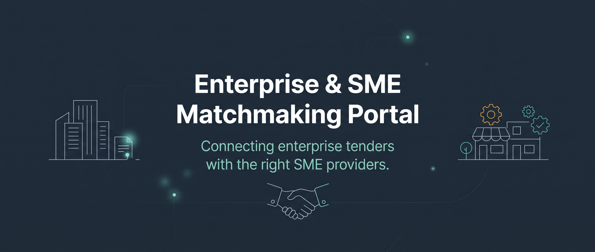

# MASLink

**AI SME opportunity matching** (YES AI Hub, Challenge 4). MASLink connects enterprise tenders, RFQs and funding
with the right SME providers.

## How it works

MASLink has a portal for each side of the match:

- **SMEs** register their business once: company details, the services they offer, the provinces and areas they
  can deliver in, and the compliance documents buyers ask for (B-BBEE certificate, tax compliance status, CIPC
  registration and more). Their dashboard shows a **profile readiness** score with the gaps holding them back,
  which documents are missing or expired, and the opportunities they've been matched to.
- **Corporates and funders** publish tenders, RFQs and grants, and find suppliers who are compliant and can
  deliver where the work is.
- **The YES Programme Team** oversees the programme across both sides.

Matching uses what SMEs put in their profile, so a complete, current profile means more and better matches.

### How applications are decided

MASLink is the fairness layer between buyers and SMEs. SMEs apply with a quoted price, a short proposal and
supporting documents (stored in Convex file storage). **Jev**, the evaluation engine
([TypeSafe’s System One model](https://docs.typesafe.ai/api), called through TypeSafe’s own API), works in two durable
[Convex workflows](https://www.convex.dev/components/workflow) (`convex/review.ts`):

   Jev doesn’t write text: it answers typed questions with probabilities (yes/no, a choice, or a level on a rubric
   MASLink defines), and every reason on the record is composed from those answers, so each one can be traced back
   to the question and the probability it rests on (`convex/reviewActions.ts`).

1. **Review**, when the SME applies: Jev checks every document behind the application (the profile’s compliance
   documents the opportunity asks for, and the files sent with it): what it is, whether it’s issued to the SME and
   still valid, whether it shows the profile’s B-BBEE level, and whether it’s complete or marked as a sample. Then
   it answers each of the buyer’s evaluation criteria: gates and B-BBEE as yes/no, functionality and other criteria
   on a five-level evidence rubric (0–100), plus an overall fit.
2. **Shortlisting**, when the buyer asks: price and B-BBEE points are calculated with the preferential procurement
   formulas (80/20 or 90/10, `convex/lib/procurement.ts`), and the shortlist follows the points ranking up to the
   size the buyer chose. Jev’s only judgement here is whether an applicant’s recorded concern is serious enough to
   keep it off; nobody is held back without a concern they can read. Every applicant gets a reason, and guardrails
   make sure only eligible applicants are shortlisted and never more than the limit. **Jev never awards:** the
   buyer decides from the shortlist.
3. **The buyer’s decision**: shortlisting, removing, declining and awarding (owners and admins, from the shortlist
   only) each require a written reason, which goes on the record and to the SME.

How it maps to South African law:

- **Constitution s217 and the PPPFA**: procurement that is fair, equitable, transparent, competitive and
  cost-effective. Points use the statutory formulas; ranking follows points, and departing from it needs a
  documented, objective reason.
- **PAJA s5**: written reasons. Every applicant gets reasons for the shortlisting outcome, and every buyer action
  needs one; SMEs see both.
- **POPIA**: consent at registration, only criteria-relevant information is used to evaluate, sensitive fields are
  encrypted at rest, and access is limited to the applicant, the buyer and MASLink staff.

Every step is on the **record** (`reviewTrail`), which can be viewed and downloaded per applicant and per
shortlisting run: what was read, how it scored and why, the points arithmetic, Jev’s recommendation and reasons,
guardrails applied, and every person’s action with their reason. MASLink staff see every run under
**Admin → Evaluations**, including the model used and its cost. The interface never names Jev to buyers or SMEs
(DESIGN.md).

### Audit trail and encryption

- **Every mutation is a command.** The function builders in `convex/functions.ts` (which every module uses
  instead of `_generated/server`) record each mutation that changes data in `commands` (which function, who ran
  it) and each document it inserted, updated or deleted in `changes` (the document before and after, and the fields
  that changed). **Admin → Audit log → All changes** shows them as field-by-field diffs, with each record's full
  history. Staff actions also appear in words under **Staff actions**. Append-only logs (the audit log, Jev's trail,
  buyer activity) aren't logged again, and Better Auth's own tables (accounts, organisations) are covered by the
  staff-action log rather than diffs.
- **Sensitive fields are encrypted at rest** with AES-256-GCM (`convex/lib/encryption.ts`): SME contact details,
  registration and CSD numbers and address, application proposals, and the text Jev read from documents. The same
  builders encrypt on write and decrypt on read, so the rest of the code sees plaintext, and the change log only
  stores ciphertext. Uploaded files are in Convex storage, which Convex encrypts at rest.

The encryption key is `DATA_ENCRYPTION_KEY` on each Convex deployment. **Back it up** (`pnpm exec convex env get
DATA_ENCRYPTION_KEY`, add `--prod` for production) somewhere safe such as a password manager: without it the
encrypted fields can't be read, and changing it makes existing values unreadable. To set one up, or after restoring
rows from before encryption:

```bash
pnpm exec convex env set DATA_ENCRYPTION_KEY "$(openssl rand -base64 32)"   # once per deployment
pnpm exec convex run encryption:encryptExisting                             # encrypts any plaintext rows
pnpm exec convex run encryption:status                                      # what's encrypted, read from storage
```

## Stack

- [Next.js 16](https://nextjs.org) (App Router, TypeScript, Cache Components) with [shadcn/ui](https://ui.shadcn.com) (radix-nova) and Tailwind CSS 4
- [Convex](https://convex.dev) for the database, backend functions and file storage
- [Better Auth](https://www.better-auth.com) running inside Convex via [`@convex-dev/better-auth`](https://labs.convex.dev/better-auth), with screens from [Better Auth UI](https://better-auth-ui.com)
- [Resend](https://resend.com) for auth emails, through the [Convex Resend component](https://www.convex.dev/components/resend)
- [Vercel](https://vercel.com) for hosting
- [pnpm](https://pnpm.io) as the package manager

## Getting started

You need Node.js 20.9+ and pnpm 12 (`corepack enable` picks up the version from `package.json`).

```bash
pnpm install
pnpm dev:convex     # first run: log in and pick the Convex project; writes .env.local
```

Leave that running (it pushes `convex/` as you save), then set the backend's environment once per Convex deployment:

```bash
pnpm exec convex env set BETTER_AUTH_SECRET "$(openssl rand -base64 32)"
pnpm exec convex env set SITE_URL http://localhost:3000
pnpm exec convex env set RESEND_API_KEY re_...
pnpm exec convex env set TYPESAFE_API_KEY apikey_...    # Jev, from console.typesafe.ai; the account needs credits
pnpm exec convex env set DATA_ENCRYPTION_KEY "$(openssl rand -base64 32)"   # back this up
# Optional. The default, onboarding@resend.dev, only delivers to your own Resend account's address
pnpm exec convex env set AUTH_EMAIL_FROM "MASLink <auth@your-verified-domain.com>"
```

In a second terminal:

```bash
pnpm dev
```

Open http://localhost:3000 and sign up at `/auth/sign-up`. In development, the SME portal has a
**Dev: fill in a sample business** button that creates a sample SME profile for your account.

### Sample data

To fill a development deployment with accounts, SMEs, enterprises (with teams, members and invitations) and
staff:

```bash
pnpm exec convex run seed:devData '{"inviterEmail":"you@example.com"}'   # inviterEmail is optional
```

It refuses to run unless the deployment's `SITE_URL` is on localhost (or `ALLOW_SEED` is `true`, for a shared test
deployment; unset it again afterwards), and it's safe to re-run: if the accounts below stop signing in on a dev
deployment, run it again.

### Dev accounts

Development deployments only. Every seed account signs in with the same password, `YesHubDev2026!`
(`SEED_PASSWORD` in `convex/seed.ts`). Never seed production: the password is public.

**MASLink staff** (admin area at `/admin`)

| Email | Name | Access |
| --- | --- | --- |
| `naledi@maslink.test` | Naledi Dube | Super admin (owner of the staff organisation) |
| `musa@maslink.test` | Musa Khoza | Admin |
| `lindiwe@maslink.test` | Lindiwe Moyo | Moderator |
| `tumi@maslink.test` | Tumi Radebe | Viewer |

**Enterprises and funders** (dashboard at `/dashboard`)

| Email | Name | Organisation | Role |
| --- | --- | --- | --- |
| `naledi.dlamini@umhlaba.test` | Naledi Dlamini | Umhlaba Property Group (verified) | Owner, Procurement |
| `johan.vanwyk@umhlaba.test` | Johan van Wyk | Umhlaba Property Group | Admin, Procurement and Facilities |
| `ayanda.nkosi@umhlaba.test` | Ayanda Nkosi | Umhlaba Property Group | Member, Human Resources |
| `priya.naidoo@umhlaba.test` | Priya Naidoo | Umhlaba Property Group | Member, Facilities |
| `sipho.mthembu@siyanda.test` | Sipho Mthembu | Siyanda Retail (awaiting verification) | Owner, Logistics |
| `lerato.molefe@siyanda.test` | Lerato Molefe | Siyanda Retail | Member, Merchandise |
| `grace@ubuntufund.test` | Grace Khumalo | Ubuntu Enterprise Development Fund (awaiting verification) | Owner |
| `tenders@umhlaba-property.test` | Umhlaba Procurement | Umhlaba Property Tenders (rejected impostor) | Owner |

**SMEs** (portal at `/sme`)

| Email | Name | Business |
| --- | --- | --- |
| `thandi@ubuntufacilities.test` | Thandi Mokoena | Ubuntu Facilities Services |
| `kabelo@lethabocatering.test` | Kabelo Sithole | Lethabo Catering & Events |
| `bongani@siyakhabuild.test` | Bongani Zulu | Siyakha Construction |
| `fatima@mzansiit.test` | Fatima Patel | Mzansi IT Solutions (suspended) |
| `pieter@karoologistics.test` | Pieter Botha | Karoo Logistics |
| `nomsa@imbalicleaning.test` | Nomsa Shabalala | Imbali Cleaning Co-operative |
| `tebogo@thusoprojects.test` | Tebogo Maluleke | Thuso Projects |
| `ayesha@kasikitchen.test` | Ayesha Jacobs | Kasi Kitchen Caterers |
| `sibusiso@izikosecurity.test` | Sibusiso Ngcobo | Iziko Security Services |

**Other accounts**

| Email | Name | What it shows |
| --- | --- | --- |
| `zanele.mahlangu@gmail.test` | Zanele Mahlangu | A new account with no profile or organisation yet |
| `kgosi@outlook.test` | Kgosi Masilo | A new account with no profile or organisation yet |
| `win-every-tender@spam.test` | Cheap Tenders 4U | A banned account (can't sign in) |

Local sign-in only works on `http://localhost:3000`, the deployment's `SITE_URL`. If another dev server already
holds port 3000, a second one starts on 3001 and sign-in fails there.

Seeded applications are scored by the rules until Jev reviews them. To have Jev review them (a fraction of a cent each):

```bash
pnpm exec convex run seed:sampleProposals     # sample quotes and proposals for Jev to score
pnpm exec convex run review:reviewExisting    # also retries failed reviews; add '{"force": true}' to review again
```

### Accounts and organisations

- **SMEs** are business accounts: one account, one SME profile, no teammates.
- **Enterprises** (companies and funders) are Better Auth organisations with members, teams and invitations. Anyone can
  create one, but it stays **unverified** until MASLink staff approve it, and only verified organisations can post
  opportunities.
- **MASLink staff** are members of the staff organisation (slug `yeshub`). Their role there is their access level
  in `/admin`, synced to the Better Auth admin role: owner → **super admin**, then **admin**, **moderator** and
  **viewer** (`src/lib/permissions.ts` lists what each can do).
- An account belongs to at most one organisation, and an SME account can't join one.

### MASLink admins

Super admins invite staff and set access levels from **Admin → Staff**. Every staff action in the admin area is
recorded in **Admin → Audit log**.

To bootstrap the first super admin, list their email in `SUPER_ADMIN_EMAILS` on the Convex deployment, and the
account becomes the staff organisation's owner when it signs up:

```bash
pnpm exec convex env set SUPER_ADMIN_EMAILS "you@example.com,teammate@example.com"   # add --prod for production
```

For an account that already exists, or to delete one from the command line (internal functions, so only the CLI
or the Convex dashboard can run them):

```bash
pnpm exec convex run platform:makeSuperAdmin '{"email":"you@example.com"}'
pnpm exec convex run admin:deleteAccount '{"email":"someone@example.com"}'   # also removes their SME profile and files
# add --prod for production
```

### Environment variables

| Variable | Where | Notes |
| --- | --- | --- |
| `CONVEX_DEPLOYMENT`, `NEXT_PUBLIC_CONVEX_URL` | `.env.local` | Written by `pnpm dev:convex` |
| `NEXT_PUBLIC_CONVEX_SITE_URL` | `.env.local` | Optional for cloud deployments (derived from `NEXT_PUBLIC_CONVEX_URL`); required for a local Convex backend (`http://127.0.0.1:3211`) |
| `BETTER_AUTH_SECRET` | Convex | Signs sessions and tokens |
| `SITE_URL` | Convex | The app's public URL; used in email links and to validate requests |
| `RESEND_API_KEY` | Convex | Emails are sent from Convex, not Next.js |
| `TYPESAFE_API_KEY` | Convex | Jev, for reviewing and shortlisting applications (TypeSafe’s API, billed on input tokens). The account needs credits |
| `DATA_ENCRYPTION_KEY` | Convex | 32 random bytes, base64, for encrypting sensitive fields. Back it up: losing it loses that data |
| `JEV_MODEL` | Convex | Optional. Defaults to `jev-latest`; pin a version such as `jev-1.14.0` for repeatable reviews |
| `SUPER_ADMIN_EMAILS` | Convex | Comma-separated emails that become MASLink super admins when they sign up |
| `AUTH_EMAIL_FROM` | Convex | Sender address on a domain verified in Resend. Until one is set, mail only reaches the Resend account owner, so sign-up doesn’t require email verification (see `convex/auth.ts`) |
| `ANTHROPIC_API_KEY` | `.env.local`, Vercel | The SME's "Improve my summary" (Professional company summary), in `src/app/api/company-summary/route.ts`. Without it the button explains that AI summaries aren't set up |
| `CONVEX_DEPLOY_KEY` | Vercel | See below |

### Scripts

| Command | What |
| --- | --- |
| `pnpm dev` | Next.js dev server |
| `pnpm dev:convex` | Convex dev deployment, watching `convex/` |
| `pnpm build` | Production build |
| `pnpm lint` | ESLint |
| `pnpm format` | Prettier (`pnpm format:check` to check only) |
| `pnpm typecheck` | Route type generation + `tsc` |
| `pnpm auth:generate` | Regenerate the Better Auth schema in `convex/betterAuth` after changing auth plugins or fields |

## Deployment

Production runs at **https://yeshub-app.vercel.app** (Vercel project `yeshub-app`) against the Convex production
deployment `posh-seahorse-411`.

`vercel.json` makes every Vercel build run `pnpm convex deploy --cmd 'pnpm build'`: it deploys the Convex
functions and schema to production first, then builds Next.js against that deployment. Vercel authenticates to
Convex with the `CONVEX_DEPLOY_KEY` environment variable (Production), and the production backend has
`BETTER_AUTH_SECRET`, `SITE_URL` and `RESEND_API_KEY` set.

To deploy from your machine:

```bash
pnpm dlx vercel link        # once, pick the yeshub-app project
pnpm dlx vercel deploy --prod
```

Pushes to `main` deploy automatically: the Vercel project is connected to this GitHub repository. It's on Vercel's
Hobby plan, which only builds commits by the project owner, so teammates open a pull request and the owner merges it.

If you use a custom domain, update the backend to match:

```bash
pnpm exec convex env set --prod SITE_URL https://your-domain.example
```

**Preview deployments** would need a Convex _preview_ deploy key as `CONVEX_DEPLOY_KEY` in Vercel's **Preview**
environment, so each branch gets its own Convex backend, plus a `SITE_URL` that matches each preview's URL for
sign-in to work. Until then, `git.deploymentEnabled` in `vercel.json` only deploys `main`.

## Project layout

| Path | What |
| --- | --- |
| `convex/schema.ts` | Database schema (`smes`: SME business profiles, keyed by Better Auth user; `auditLog`: staff actions) |
| `convex/smes.ts` | SME profile queries and mutations |
| `convex/auth.ts` | Better Auth options and instance: email/password, organisations (enterprises with teams, and MASLink staff), admin, and the hooks that enforce access levels and write the audit log |
| `convex/betterAuth/` | Locally installed Better Auth component: generated schema, adapter, component functions |
| `convex/admin.ts` | The admin area's queries and mutations (SMEs, organisations, staff), each checked against the caller's access level |
| `convex/platform.ts`, `convex/audit.ts` | Account state, staff roles and the audit log |
| `convex/functions.ts` | The query and mutation builders every module uses: command log and field encryption |
| `convex/lib/encryption.ts`, `convex/encryption.ts` | AES-256-GCM field encryption, and its migration and status |
| `convex/seed.ts` | Development sample data |
| `convex/review.ts`, `convex/reviewActions.ts` | Jev’s review and decision workflows, the paper trail, and the Jev calls |
| `convex/lib/jev.ts`, `convex/lib/procurement.ts` | The TypeSafe client, and the price and B-BBEE points formulas |
| `convex/email.tsx` | Auth emails via Resend, using `@better-auth-ui/react/email` templates |
| `convex/http.ts` | Mounts the Better Auth HTTP routes on Convex |
| `src/app/api/auth/[...all]/route.ts` | Proxies `/api/auth/*` from Next.js to Convex |
| `src/app/auth/` | Auth screens with their own layout |
| `src/app/(marketing)/` | Landing page (`/`) |
| `src/app/start/` | Where sign-in lands: sends each account to its portal, or asks new accounts if they're an SME or an enterprise |
| `src/app/sme/` | SME portal (`/sme`) and the registration wizard (`/sme/register`) |
| `src/app/dashboard/` | Enterprise dashboard (`/dashboard`), for organisation members |
| `src/app/admin/` | MASLink admin (`/admin`), for staff: users, SMEs, organisations, staff and the audit log |
| `src/app/(app)/` | Account settings, with the app header |
| `src/components/portal/` | Shared portal shell, sidebar and access guard |
| `src/components/sme-portal/`, `enterprise/`, `admin/` | Each portal's navigation and screens |
| `src/lib/sme/` | SME domain logic shared by the UI: profile readiness, document status |
| `src/lib/permissions.ts` | Access control shared by Convex and the UI: staff access levels and organisation roles |
| `src/components/auth/**`, `src/components/ui/**` | Better Auth UI and shadcn/ui components (owned code, from registries) |

## Version pins: read before upgrading

`@convex-dev/better-auth@0.12.x` only supports `better-auth <1.7` (its 1.7 migration is unreleased), and
`@better-auth-ui/*` 1.7+ requires `better-auth >=1.7`. So:

- `better-auth` and every `@better-auth/*` package are pinned to `~1.6.33`.
- `@better-auth-ui/react` and `@better-auth-ui/core` are pinned to exactly `1.6.45` (the last 1.6 release).
- The components in `src/components/auth` were built from the better-auth-ui `v1.6.45` tag's registry, **not**
  the hosted registry at better-auth-ui.com (which serves 1.7 components). Don't run
  `pnpm dlx shadcn add @better-auth-ui/...` until you've upgraded everything to 1.7 together.
- `src/components/providers.tsx` casts `authClient` for `ConvexBetterAuthProvider`; Convex's type for that prop
  doesn't match better-auth 1.6.19+'s session type. Remove the cast once `@convex-dev/better-auth` supports 1.7.
